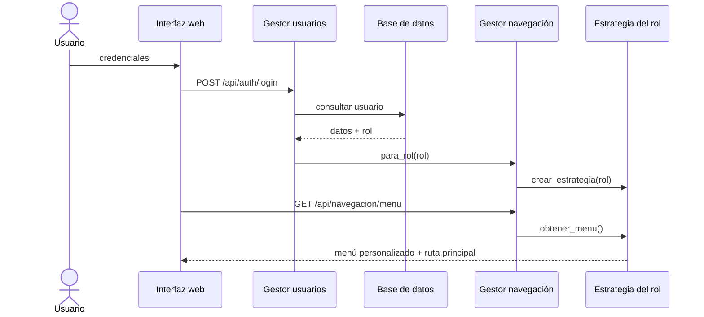

# LabCloud Intelligent

Prototipo de la **Actividad 6 – Navegando mareas: estrategias de navegación en la arquitectura de software**.
Plataforma web para laboratorio clínico con **navegación adaptativa según el rol** (Recepción, Analista,
Administrador) aplicando los patrones **Strategy**, **Command** y **Observer**.

- **Arquitectura:** monolito modular en tres capas (presentación, lógica de negocio, datos).
- **Backend:** Python 3.12 + FastAPI, gestionado con **uv**.
- **Frontend:** Next.js 16 (React 19) exportado como sitio estático y servido por el mismo proceso de FastAPI.
- **Base de datos:** SQLite (`labcloud.db`, se crea y se llena con datos de demostración al primer arranque).

Un solo comando levanta todo el sistema en `http://127.0.0.1:8000`: API en `/api`, documentación en `/docs`
e interfaz web en `/`.

## Puesta en marcha

Requisitos: [uv](https://docs.astral.sh/uv/) y Node.js 20+.

```bash
make install   # uv sync + npm install
make run       # compila la interfaz y arranca el monolito en http://127.0.0.1:8000
```

Sin `make`:

```bash
uv sync
cd frontend && npm install && npm run build && cd ..
uv run labcloud
```

Modo desarrollo (recarga en caliente, dos terminales): `make dev-api` (FastAPI en :8000) y `make dev-web`
(Next.js en :3000, que reenvía `/api` al backend).

Pruebas: `make test` (pytest + chequeo de tipos de TypeScript).

### Cuentas de demostración

| Rol | Correo | Contraseña |
|---|---|---|
| Recepción | `recepcion@labcloud.test` | `recepcion123` |
| Analista | `analista@labcloud.test` | `analista123` |
| Administrador | `admin@labcloud.test` | `admin123` |

La pantalla de ingreso permite elegirlas con un clic. Para reiniciar los datos: `make reset-db`.

## Arquitectura

```
labcloud/                       Monolito Python
├── main.py                     Punto de entrada: API + interfaz estática en un solo proceso
├── presentacion/               Capa de presentación (HTTP)
│   ├── rutas.py                Routers por módulo funcional y flujo SSE de eventos
│   ├── dependencias.py         Autenticación por token y control de acceso por rol
│   └── esquemas.py             Validación de entrada (Pydantic)
├── negocio/                    Capa de lógica de negocio
│   ├── navegacion/
│   │   ├── estrategias.py      Strategy: EstrategiaNavegacion + una clase por rol + NavegacionConvencional
│   │   ├── gestor.py           GestorNavegacion (contexto del Strategy)
│   │   └── comandos.py         Command: ComandoNavegacion, IrAModulo, InvocadorNavegacion (historial/deshacer)
│   ├── eventos.py              Observer: SujetoEventos, RegistroEventosObserver, DifusorTiempoRealObserver
│   ├── servicios.py            Gestor de usuarios, pacientes, órdenes, muestras, inventario, indicadores, pruebas
│   ├── catalogo.py             Catálogo de exámenes
│   └── seguridad.py            Hash PBKDF2 y tokens de sesión
└── datos/                      Capa de acceso a datos
    ├── database.py             Esquema y conexión SQLite
    ├── repositorios.py         Un repositorio por entidad
    └── seed.py                 Datos de demostración
frontend/                       Interfaz web (Next.js, exportación estática)
├── components/Shell.tsx        Menú adaptativo: pinta la estrategia del rol y ejecuta comandos
├── lib/sesion.tsx              Sesión, menú del rol, navegar() y atras() (Command)
├── lib/eventos.tsx             Observer en la interfaz: recibe SSE y notifica a los componentes
└── app/(app)/…                 Módulos: pacientes, órdenes, muestras, procesamiento, resultados,
                                usuarios, inventario, indicadores, configuración y pruebas
tests/                          Pruebas unitarias (patrones) y de integración (API)
```

### Flujo de navegación (sección 6.3)

`Usuario → Interfaz web → Autenticación → Identificación del rol → Gestor de navegación → Estrategia → Módulo funcional → Base de datos`



### Patrones de diseño

| Patrón | Implementación | Qué resuelve |
|---|---|---|
| **Strategy** | `EstrategiaNavegacion` y `NavegacionRecepcion`, `NavegacionAnalista`, `NavegacionAdministrador`, registradas con `@registrar_estrategia`. `GestorNavegacion.establecer_estrategia()` permite cambiarlas en ejecución. | Cada rol recibe sus rutas prioritarias. **Agregar un rol = agregar una clase**; el gestor y la interfaz no cambian (probado en `test_agregar_un_rol_solo_requiere_una_nueva_estrategia`). |
| **Command** | Cada opción del menú es un `IrAModulo`. La interfaz no navega directamente: llama a `POST /api/navegacion/comandos/{clave}` y el `InvocadorNavegacion` valida el permiso, registra el historial y devuelve la ruta. `POST /api/navegacion/deshacer` implementa el botón *Volver*. | Acciones de navegación desacopladas, auditables y reversibles. |
| **Observer** | `SujetoEventos` notifica a `RegistroEventosObserver` (persiste) y a `DifusorTiempoRealObserver` (envía SSE según el rol). En la interfaz, `EventosProvider` reenvía los eventos a los componentes suscritos con `useAlEvento`. | Al crear una orden, procesar una muestra o bajar el stock, las pantallas afectadas se actualizan solas y aparece la notificación. |

### Navegación por rol (Tablas 1 y 4)

| Rol | Opciones prioritarias | Página inicial |
|---|---|---|
| Recepción | Pacientes, Nueva orden, Seguimiento de muestra | `/inicio` |
| Analista | Muestras pendientes, Procesamiento, Resultados | `/muestras/pendientes` |
| Administrador | Usuarios, Inventario, Indicadores, Configuración | `/inicio` |

El acceso se valida dos veces: la interfaz solo muestra las rutas de la estrategia y la API rechaza con
`403` las operaciones de otros roles.

## Pruebas de navegación (sección 8)

En **Pruebas de navegación** (`/pruebas`, disponible para todos los roles) se ejecutan los escenarios:

| Prueba | Rol | Tarea |
|---|---|---|
| P1 | Recepción | Acceder a la opción Nueva orden |
| P2 | Analista | Acceder a Muestras pendientes |
| P3 | Administrador | Acceder a Inventario |

Cada escenario puede ejecutarse con la **navegación convencional** (menú jerárquico único) o con la
**navegación optimizada** (estrategia del rol). Al pulsar *Iniciar* aparece el menú y arranca el cronómetro;
cada clic cuenta como paso y elegir una opción equivocada cuenta como error. Los resultados se guardan en
SQLite y se consolidan en la **Tabla 6** (promedios de pasos, reducción porcentual, tiempos y errores), que
también aparece en *Indicadores*.

Con el menú convencional, el número mínimo de pasos es 3 para P1 y P2 y 2 para P3; con la navegación
optimizada es 1 en los tres casos.

## API principal

| Método y ruta | Descripción |
|---|---|
| `POST /api/auth/login` | Autentica y devuelve token + ruta principal del rol |
| `GET /api/navegacion/menu` | Menú de la estrategia del usuario |
| `GET /api/navegacion/menu/convencional` | Menú jerárquico de referencia |
| `POST /api/navegacion/comandos/{clave}` | Ejecuta un comando de navegación |
| `POST /api/navegacion/deshacer` | Vuelve a la ruta anterior |
| `GET/POST /api/pacientes`, `/api/ordenes` | Recepción |
| `GET /api/muestras`, `POST /api/muestras/{id}/procesar`, `POST /api/muestras/{id}/resultados` | Analista |
| `GET/POST /api/usuarios`, `/api/inventario`, `GET /api/indicadores` | Administrador |
| `GET /api/eventos/stream` | Notificaciones en tiempo real (SSE) |
| `GET /api/pruebas/resumen`, `POST /api/pruebas/resultados` | Métricas de navegación |

Documentación interactiva completa en `/docs`.
